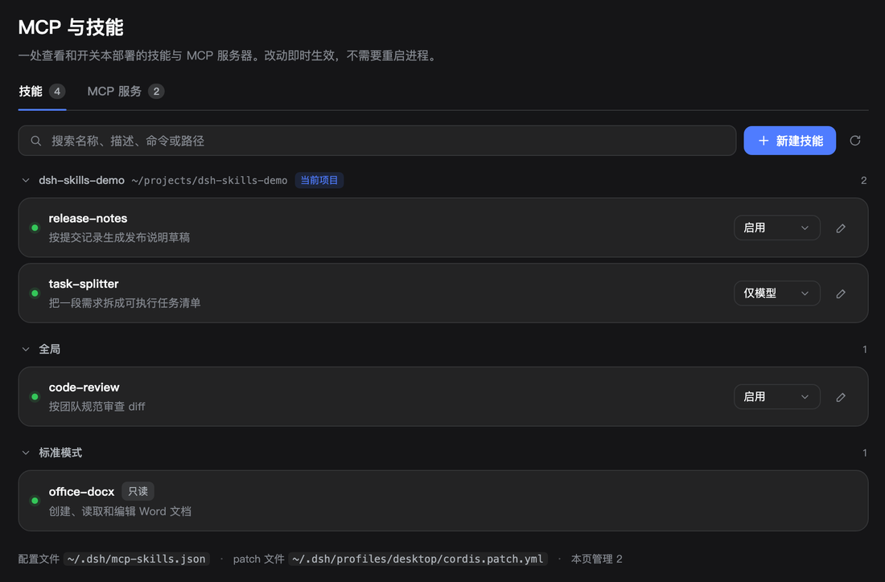
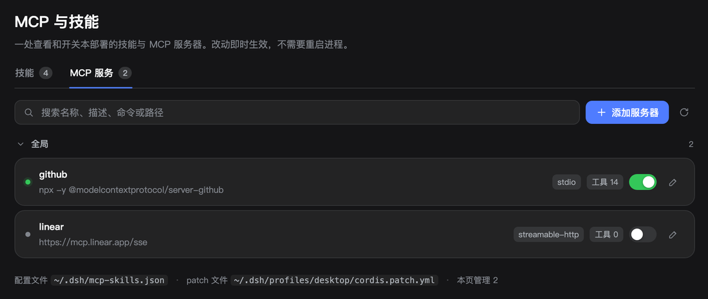
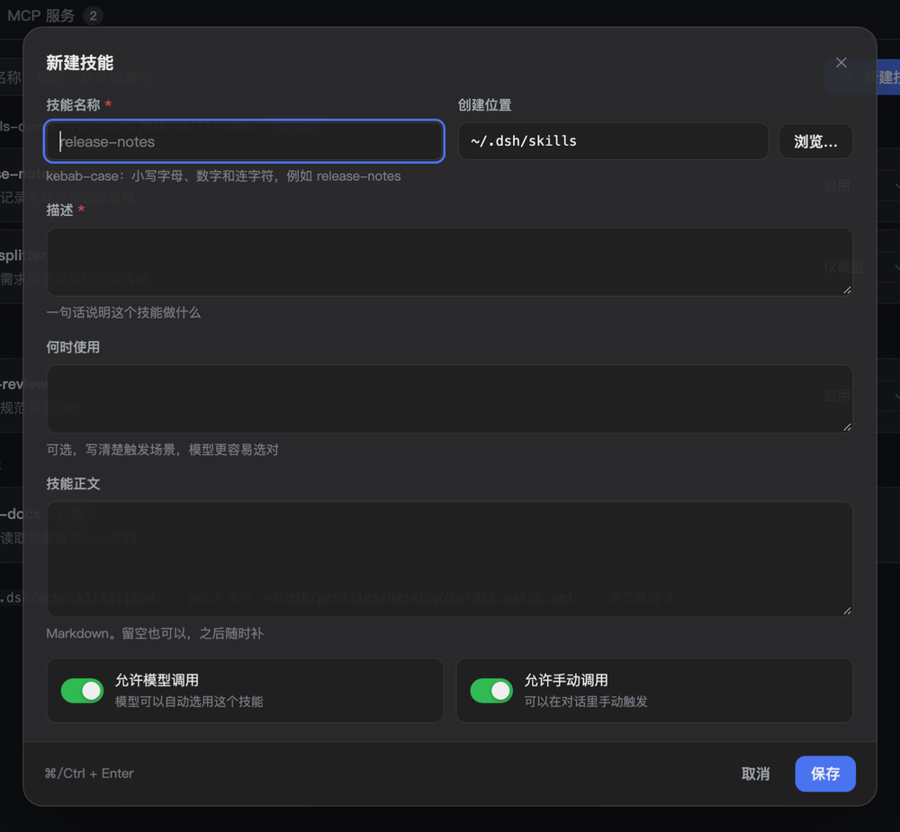
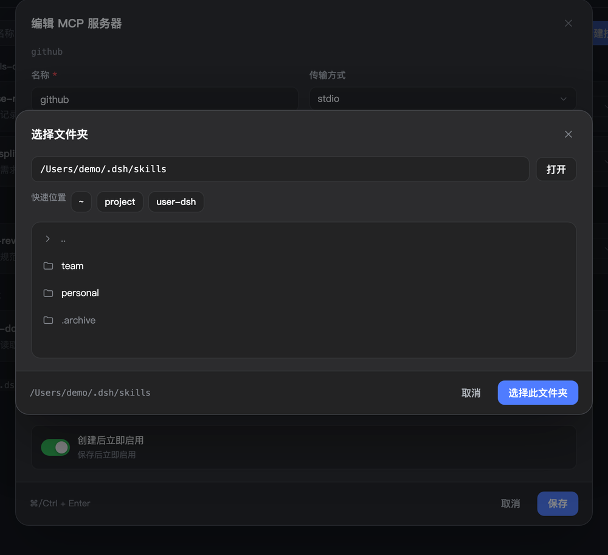
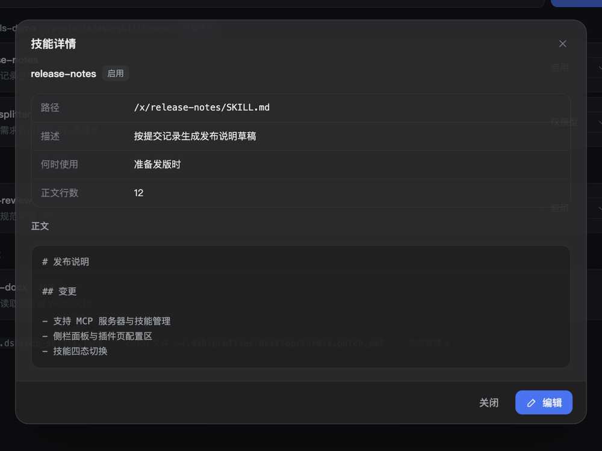

<div align="center">


# dsh-mcp-skills-board

<p><b>MCP server and skill management for DeepSeek Harness</b></p>

[](https://www.npmjs.com/package/dsh-mcp-skills-board)
[](LICENSE)
[](#install)
[中文](README.md)

</div>

One sidebar entry and one plugin-page config section. Inspect and toggle MCP servers, switch skills between four states, and create or edit skill files without leaving the UI.



## Features

| Area | Capability |
| --- | --- |
| MCP servers | Lists every composed `@deepseek-ai/dsh-mcp-client` row with a status light, tool count and tool names; one toggle per row; add, edit and remove stdio or streamable-http servers |
| Skills | Scans `.dsh/skills`, `.agents/skills` and custom roots, groups rows by source root with the current project pinned; each skill switches between enabled / manual-only / model-only / off, and can be renamed/moved, duplicated or deleted |
| Create and edit | A form for name, description, when-to-use and body, with invocation switches and a folder picker for the target root |
| Import / export | Reads Codex `config.toml`, Claude/Cursor `mcpServers` JSON, or this plugin's own JSON export; export can be copied or downloaded |
| Templates | One-click templates for filesystem, github, fetch, git, sqlite and brave-search in the add-server form |
| Secrets | env and header values accept `@env:NAME`, which renders `!!js process.env.NAME` so the secret is not stored in the patch file |
| Preset skills | Skills provided by agent presets are listed read-only because they live inside the installed bundle |
| Safety | Only the managed config block and files inside skill roots are rewritten; removing a server applies to servers added here and asks for confirmation |

## Screens



| New skill | Folder picker |
| --- | --- |
|  |  |



Every control is hand-built: buttons, inputs, selects, switches, dialogs and toasts follow the active DSH theme instead of native widget styling. Dialogs size themselves to their content and do not scroll in normal use; text areas grow with their content and scroll only when the content exceeds the field. Press `/` to focus the search box.

## Install

Requires DSH `>= 0.2.0-rc.2 < 0.3.0`. The range lives in `peerDependencies`, so the plugin manager's compatibility check rejects a mismatch.

```bash
dsh plugin --profile desktop add dsh-mcp-skills-board
```

You can also use **Plugins → Add plugin** and enter the package name, then refresh the page once.

Local development:

```bash
dsh plugin --profile desktop add link:/absolute/path/to/dsh-mcp-skills-board
```

## Where data lives

- `$DSH_HOME/mcp-skills.json` (default `~/.dsh/mcp-skills.json`, mode 0600): the source of truth for servers managed here;
- A fenced block in `$DSH_HOME/profiles/<profile>/cordis.patch.yml`, generated from that JSON:

```yaml
# >>> dsh-mcp-skills-board (managed — edit MCP servers from Settings → MCP & Skills)
- insert:
    - id: "mcp-github"
      name: "@deepseek-ai/dsh-mcp-client"
      config:
        serverName: "github"
        transport: "stdio"
        command: "npx"
        args:
          - "-y"
          - "@modelcontextprotocol/server-github"
        toolCallTimeoutMs: 60000
        failOnStartupError: false
      disabled: false
# <<< dsh-mcp-skills-board
```

Everything outside the block stays untouched. MCP rows declared elsewhere are never rewritten; toggling one only appends an id-targeted `disabled:` override.

Skill files are written under the chosen root (default `~/.dsh/skills`), one directory per skill:

```
~/.dsh/skills/release-notes/SKILL.md
```

Saving rewrites only the managed frontmatter keys (name, description, when-to-use, the two invocation switches) and the body; other custom frontmatter keys are preserved.

## Compared with Codex

| Codex | This plugin |
| --- | --- |
| `[mcp_servers.*]` in `config.toml` | `mcp-skills.json` plus the generated patch block |
| Settings → MCP servers | MCP servers tab |
| Add server form | Add server form |
| `/mcp` | Row status light, tool count, details |
| `enabled = false` | Row switch, definition kept |
| `startup_timeout_sec`, `tool_timeout_sec` | `toolCallTimeoutMs`; the startup timeout belongs to the MCP SDK |
| `bearer_token_env_var`, `env_http_headers` | Not supported; env and headers are written to the patch file in plain text (0600) |
| `codex mcp login` (OAuth) | Not supported; DSH's MCP client has no OAuth |
| `[[skills.config]] enabled = false` | Four-state selector rewriting the two frontmatter keys |
| Skill locations | Disk scan roots plus preset scopes (read-only) |

## Limits

- No OAuth: servers that require it are rejected by DSH's MCP bridge and the error appears in the row details;
- Secrets are plain text in `cordis.patch.yml` (0600) by default. Writing a value as `@env:NAME` renders `!!js process.env.NAME` instead, keeping the secret in the environment;
- Preset skills are read-only;
- Profiles without `patchReload: live` apply MCP changes on the next launch; the page says so;
- Removal only applies to servers added from this page.

## Structure

```text
package.json                  # dsh.bundle.patch, dsh.client.platform, icon, exports
cordis.patch.yml              # inserts the id=mcp-skills row
lib/index.js                  # host: state/action/browse routes, skill scan and writes, MCP patch block
lib/client.js                 # browser: panel, plugin page section, custom controls and dialogs
locale/zh.json                # plugin page metadata (meta.title / meta.description)
locale/en.json                # English fallback
assets/icon.svg               # plugin list and detail icon
assets/screenshot-*.png       # screenshots used by this document
assets/social-preview.png     # GitHub social preview (1280×640)
test/                         # host integration tests
```

The plugin page title and description come from `readPluginMeta`: it reads the exported `locale/en.json` and the `<lang>.json` files beside it, falling back to `package.json`; the icon comes from the `icon` field. Those subpaths must be listed in `exports`.

## Development

```bash
npm test
```

Covers the state/action routes, server add/edit/toggle/remove, skill policy writes, skill create/read/save, folder browsing and out-of-root rejection, and the auth fence.

## Community

Promoted in the [LINUX DO](https://linux.do) community.

## License

MIT. The sidebar glyph reuses the path data of `IconSkillOutlineRegular` from `@deepseek-ai/dsh-client-ui-primitives` (MIT) so it matches DSH's icon weight.
