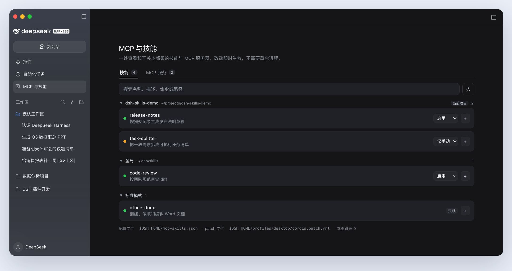
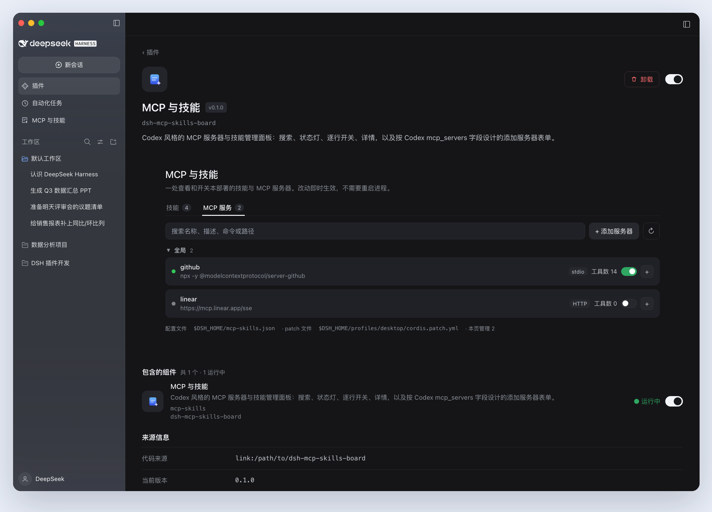

# dsh-mcp-skills-board

[English](README.en.md)

DeepSeek Harness 的 MCP 服务器与技能管理面板。页面参考 Codex 的 MCP 设置：搜索框、技能和 MCP 服务两个分页、状态灯、每行一个开关、可展开详情，以及按 `[mcp_servers.*]` 字段做的添加服务器表单。



截图为示例数据。

## 入口

- 侧栏「MCP 与技能」。
- 插件 → 已安装插件 → dsh-mcp-skills-board，里面的配置区。



## 功能

| 区域 | 说明 |
| --- | --- |
| 技能 | 扫描 `.dsh/skills`、`.agents/skills` 和自定义根，按来源目录分组，当前项目排在前面。每个技能可在启用、仅手动、仅模型、停用之间切换 |
| 预设技能 | Agent 预设自带的技能以只读方式列出，文件在安装包内 |
| MCP 服务器 | 列出组合里所有 `@deepseek-ai/dsh-mcp-client` 行，显示状态灯、工具数和工具名。每行一个启停开关 |
| 添加与编辑 | stdio 填命令、参数、环境变量、工作目录；Streamable HTTP 填 URL、请求头。另有工具超时和创建后启用 |
| 删除 | 只删本页添加的服务器，点两次确认 |

技能开关改写 `SKILL.md` 的两个 frontmatter 键，文件监视器会在下一步重新发布目录。MCP 的改动写进 profile 的 patch 文件，`patchReload: live` 的 profile 就地生效。

## 安装

要求 DSH `>= 0.2.0-rc.2 < 0.3.0`，范围写在 `peerDependencies` 里，插件管理器的兼容性检查会拦住版本不匹配。

```bash
dsh plugin --profile desktop add dsh-mcp-skills-board
```

也可以在「插件 → 添加插件」里填包名。

本地开发用 link 安装：

```bash
dsh plugin --profile desktop add link:/absolute/path/to/dsh-mcp-skills-board
```

装完刷新一次 Web 页面，之后不需要重启。

卸载：

```bash
dsh plugin --profile desktop remove dsh-mcp-skills-board
```

## 数据位置

- `$DSH_HOME/mcp-skills.json`，默认 `~/.dsh/mcp-skills.json`，权限 0600。本页添加的服务器定义都在这里。
- `$DSH_HOME/profiles/<profile>/cordis.patch.yml` 里的一个带围栏的块：

```yaml
# >>> dsh-mcp-skills-board (managed — edit MCP servers from Settings → MCP & Skills)
- insert:
    - id: "mcp-github"
      name: "@deepseek-ai/dsh-mcp-client"
      config:
        serverName: "github"
        transport: "stdio"
        command: "npx"
        args:
          - "-y"
          - "@modelcontextprotocol/server-github"
        env:
          GITHUB_TOKEN: "..."
        toolCallTimeoutMs: 60000
        failOnStartupError: false
      disabled: false
# <<< dsh-mcp-skills-board
```

块外的内容保持原样。别处声明的 MCP 行不会被改写，启停只追加一条按 id 定向的 `disabled:` 覆盖。

## 与 Codex 的对应

| Codex | 本插件 |
| --- | --- |
| `config.toml` 的 `[mcp_servers.*]` | `mcp-skills.json` 加生成的 patch 块 |
| Settings → MCP servers | MCP 服务分页 |
| Add server 表单 | 添加服务器表单 |
| `/mcp` | 行状态灯、工具数、详情 |
| `enabled = false` | 行开关，定义保留 |
| `startup_timeout_sec`、`tool_timeout_sec` | `toolCallTimeoutMs`；启动超时由 MCP SDK 控制 |
| `bearer_token_env_var`、`env_http_headers` | 不支持；env 和 headers 明文写入 patch 文件，权限 0600 |
| `codex mcp login` | 不支持，DSH 的 MCP 客户端没有 OAuth |
| `[[skills.config]] enabled = false` | 四态选择器，改写两个 frontmatter 键 |
| 技能位置 | 磁盘扫描根加预设作用域，预设部分只读 |

## 限制

- 没有 OAuth 登录。需要 OAuth 的服务器会被 DSH 的 MCP 桥拒绝，错误显示在行详情里。
- 密钥明文保存在 `cordis.patch.yml`，权限 0600。如果不希望明文，可以在 shell 里导出环境变量，把该行改成 `!!js process.env.X`，页面会把它当外部行，只保留启停。
- 预设技能只读。
- profile 没有 `patchReload: live` 时，改动下次启动生效，页面会提示。
- 删除只针对本页添加的服务器。

## 目录

```
package.json          # dsh.bundle.patch、dsh.client.platform、icon 和 exports
cordis.patch.yml      # 插入 id=mcp-skills 行
lib/index.js          # 宿主：state 和 action 路由、技能扫描、frontmatter 写入、patch 块
lib/client.js         # 浏览器：侧栏面板和插件页配置区
locale/zh.json        # 插件页展示信息，meta.title 和 meta.description
locale/en.json        # 英文回退
assets/icon.svg       # 插件列表和详情页图标
test/                 # 宿主集成测试
```

插件页的标题和描述由 `readPluginMeta` 读取：先找包导出的 `locale/en.json` 和同目录下的
`<lang>.json`，缺字段时回退到 `package.json`。图标取清单的 `icon` 字段。这些子路径要写进
`exports`，否则 Node 解析不到。

## 开发

```bash
npm test
```

覆盖 state 和 action 路由、服务器增删改、启停、技能策略写入、认证栅栏。

## 许可证

MIT。侧栏图标复用了 `@deepseek-ai/dsh-client-ui-primitives`（MIT）中 `IconSkillOutlineRegular` 的路径数据，以便和 DSH 自身的图标粗细一致。
